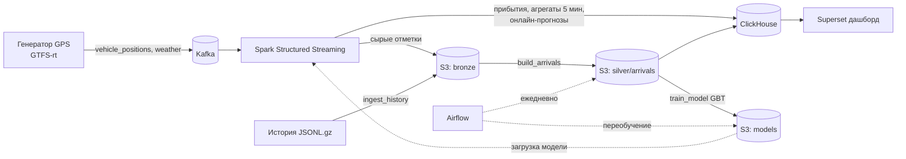

# 🚌 Аналитическая платформа городского транспорта в реальном времени

Учебный Big Data-проект (курс Samsung × VK Cloud). Платформа принимает поток GPS-отметок
общественного транспорта, считает задержки относительно расписания, находит «узкие места»
маршрутов и **прогнозирует задержку на 3 остановки вперёд** точнее простых подходов.

| Что | Чем |
|---|---|
| Поток GPS-отметок (формат GTFS-realtime) | **Kafka** |
| Озеро данных bronze → silver → gold (Parquet) | **S3**: MinIO локально, VK Object Storage в облаке |
| Стриминг + батч + ML | **Apache Spark 3.5** (Structured Streaming, MLlib GBT) |
| Аналитическое хранилище и витрины | **ClickHouse** |
| Оркестрация (ночной пересчёт и переобучение) | **Airflow** |
| Дашборд | **Superset** |

## Архитектура



**Поток данных.**
1. Генератор моделирует город: 40 маршрутов, ~2 100 остановок, ~9 400 рейсов в день (≈2 млн GPS-отметок в день).
   Задержки складываются из пробок (час пик, зона города), погоды, «узких мест», инцидентов и шума.
2. `stream_processing.py` читает Kafka. Сырые отметки уходят в bronze. Из отметок `STOPPED_AT` с дедупликацией
   получаются прибытия на остановки, задержка считается относительно расписания GTFS. Прибытия и агрегаты
   по 5 минут пишутся в ClickHouse, туда же идёт **онлайн-прогноз** задержки на 3 остановки вперёд.
3. Ночью Airflow пересобирает silver-слой за прошедший день, переобучает модель и выкладывает новую версию,
   а стрим подхватывает её сам.

## Быстрый старт

Нужно: Docker Desktop (выделите ему **≥ 10–12 ГБ RAM**, 4+ CPU) и ~10 ГБ свободного диска.

```bash
cp .env.example .env
make up                    # поднять инфраструктуру (первая сборка образов 5–10 мин)
make bootstrap DAYS=14     # сгенерировать 14 дней истории, загрузить в озеро и ClickHouse, обучить модель
make stream                # запустить «живой» поток: генератор -> Kafka -> Spark Streaming
```

<details><summary><b>Запуск без make (Windows / PowerShell) — пошагово</b></summary>

### 1. Подготовка и запуск контейнеров
```powershell
Copy-Item .env.example .env
docker compose up -d --build
```

> 💡 **Если на ПК 16 ГБ RAM или меньше:**  
> Рекомендуется в `.env` выставить:
> ```env
> SPARK_WORKER_CORES=2
> SPARK_WORKER_MEMORY=1536m
> ```

---

### 2. Генерация данных (расписание + 14 дней истории)
```powershell
docker compose run --rm generator static --out /data/gtfs
docker compose run --rm generator history --out /data/raw --days 14
```

---

### 3. Обработка данных и обучение модели

**Вариант А — через Airflow (в 1 клик):**
1. Откройте веб-интерфейс: http://localhost:8081 (`admin` / `admin`).
2. Включите тумблер (**Unpause**) у DAG **`transit_bootstrap`** и нажмите **Trigger**.

**Вариант Б — через консоль (Spark Submit):**
```powershell
# Шаг 1: Загрузка расписания GTFS в озеро (silver/gtfs/sched) и ClickHouse
docker compose exec spark-master spark-submit jobs/ingest_static.py

# Шаг 2: Загрузка истории в озеро Bronze (bronze/vehicle_positions) и погоды
docker compose exec spark-master spark-submit jobs/ingest_history.py

# Шаг 3: Расчет прибытий и задержек в озеро Silver (silver/arrivals) и ClickHouse
docker compose exec spark-master spark-submit jobs/build_arrivals.py --all

# Шаг 4: Обучение модели градиентного бустинга (GBT)
docker compose exec spark-master spark-submit jobs/train_model.py --days 21 --test-days 3 --sample 0.5
```
*(Для машин с ограниченным объёмом RAM на шаге 4 можно указать `--sample 0.2`)*

---

### 4. Запуск живого стриминга (Kafka -> Spark Streaming -> ClickHouse)
```powershell
docker compose --profile stream up -d --build producer spark-streaming
```

Остановка стриминга:
```powershell
docker compose --profile stream stop producer spark-streaming
```

</details>

| Сервис | Адрес | Логин |
|---|---|---|
| Superset (дашборд) | http://localhost:8088/superset/dashboard/transit/ | admin / admin |
| Airflow | http://localhost:8081 | admin / admin |
| Spark Master UI | http://localhost:8080 | — |
| Kafka UI | http://localhost:8085 | — |
| MinIO (S3) | http://localhost:9001 | minioadmin / minioadmin |
| ClickHouse HTTP | http://localhost:8123 | transit / transit |

Сколько это занимает: генерация 14 дней ≈ 3–5 мин (≈28 млн отметок, ≈550 МБ gz), загрузка в bronze ≈ 5–10 мин,
обучение ≈ 10–20 мин на ноутбуке. Для «настоящего» объёма возьмите `DAYS=30` или больше (60+ млн отметок).

## Структура репозитория

```
generator/transit_sim/   синтетический город: сеть и GTFS (network.py), модель задержек (delay_model.py), CLI
spark/common/            SparkSession + S3 + ClickHouse, схемы, общие преобразования, признаки ML
spark/jobs/              ingest_static, ingest_history, build_arrivals, train_model, stream_processing, benchmark
clickhouse/init.sql      таблицы фактов, справочники, витрины-представления
airflow/dags/            transit_bootstrap (разовая загрузка), transit_daily (каждую ночь)
superset/                конфиг и автосоздание дашборда через API
scripts/local_validation.py  проверка модели без кластера (pandas + sklearn)
tests/                   pytest на генератор
docs/                    результаты проверки, ручная настройка Superset, деплой в VK Cloud
```

## ML: прогноз задержки на 3 остановки вперёд

Строка обучающей выборки соответствует событию «ТС прибыло на остановку k», цель — задержка на остановке k+3.

Признаки:
- текущая задержка и её тренд за 3 остановки;
- плановое время в пути и число «центральных» перегонов впереди;
- час, день недели, выходной;
- погода (осадки, снег, температура);
- историческая «норма» прироста задержки на этом участке в этот период суток (target encoding по обучающим дням);
- **что происходит впереди**: прирост задержки у машин, прошедших следующие перегоны в предыдущие 15 минут;
- маршрут (категориальный), номер остановки, направление.

Результаты проверки (`scripts/local_validation.py`: 14 дней, обучение на 11, тест на 3 последних, 643 тыс. тестовых строк):

| Подход | MAE, мин | ±1 мин |
|---|---|---|
| Расписание (задержка = 0) | 4.99 | 36% |
| Текущая задержка сохранится | 0.96 | 71% |
| Текущая + историческая норма | 0.61 | 82% |
| **Gradient Boosting** | **0.43** | **92%** |

Ошибка ниже на 55%, чем у подхода «текущая задержка сохранится». В Spark (MLlib `GBTRegressor`) цифры будут близкими,
но не идентичными: другая реализация бустинга и выборка 50%. Реальные метрики каждого запуска пишутся в
`transit.model_metrics`.

> ⚠️ Данные синтетические, это честно указано в отчёте. Генератор пишет стандартный GTFS, поэтому
> `data/gtfs` можно заменить реальным фидом города, а продюсер — адаптером к GTFS-realtime.

## Полезные запросы ClickHouse (`make ch`)

```sql
SELECT * FROM v_daily ORDER BY service_date;
SELECT * FROM v_bottlenecks ORDER BY avg_delay_growth_min DESC LIMIT 10;
SELECT model, mae_min, within_1min FROM model_metrics WHERE run_id = (SELECT max(run_id) FROM model_metrics);
SELECT * FROM v_prediction_quality ORDER BY t DESC LIMIT 20;      -- онлайн-качество прогноза
SELECT * FROM benchmark ORDER BY created_at DESC;                 -- pandas vs Spark
```

## Если что-то не работает

- **Spark-задача висит в WAITING**: стрим занимает 2 ядра, а батчу нужно ещё 4. Остановите стрим (`make stream-stop`) или увеличьте `SPARK_WORKER_CORES`.
- **OOM у воркера**: уменьшите `DAYS` или поднимите `SPARK_WORKER_MEMORY` и память Docker.
- **ClickHouse: Authentication failed**: том создан со старым паролем, выполните `make clean`.
- **В Superset часть графиков с ошибкой**: соберите их руками по `docs/superset_manual.md` (это 5 минут).
- **Стрим пишет «модели пока нет»**: это нормально до первого `make bootstrap`/`make train`. Прибытия и агрегаты всё равно считаются.

Перенос в VK Cloud описан в [docs/vk_cloud.md](docs/vk_cloud.md).
